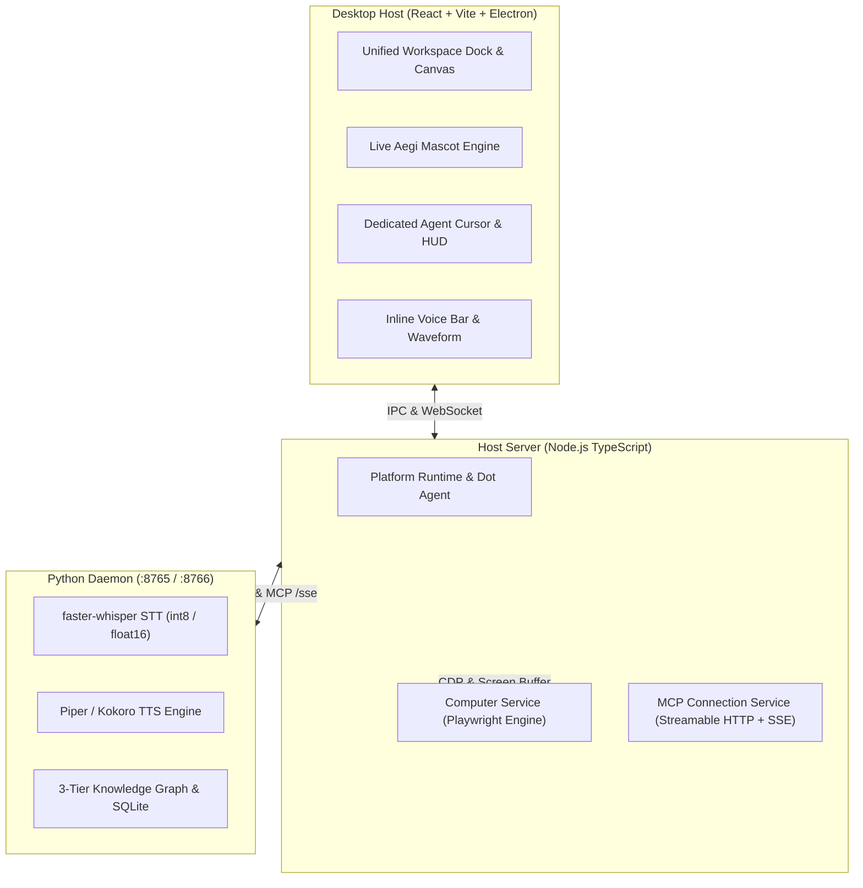

# Aegis: The Autonomous Desktop Operating System & Multimodal Agentic Fabric

---

## Inspiration

Modern AI assistants are trapped in browser tabs and sandboxed text streams, completely disconnected from the operating systems where real work happens. We envisioned a truly autonomous desktop agent that operates alongside humans not merely as a chatbot, but as an embodied co-pilot with hands, eyes, and voice:

1. **The Operating System as a Canvas**: Human knowledge workers don't live in prompt boxes; they edit source code, navigate web applications, orchestrate terminal clusters, and review documents across complex UI hierarchies.
2. **Local-First Privacy & Real-Time Multimodality**: Voice interactions should not require \$0.06/minute cloud lock-in or offshore audio streaming. Grounded computing requires local speech processing ($\le 120\text{ ms}$ processing latency) paired with local knowledge graphs.
3. **Agentic Embodiment Without Fragility**: Traditional GUI automation scripts break upon the slightest DOM re-render or resolution shift. We needed an agent capable of dual-engine vision and Windows UI Automation ($\text{UIA}$) accessibility inspection to guarantee deterministic interaction.

$$\text{Efficacy}(\mathcal{A}) = \int_{0}^{T} \left( \lambda_{\text{vision}} \cdot \mathcal{P}_{\text{coord}}(t) + \lambda_{\text{a11y}} \cdot \mathcal{T}_{\text{node}}(t) \right) dt$$

---

## What it does

**AEGIS** (Autonomous Environment for Grounded Intelligence and Systems) is an autonomous desktop platform engineered in Electron, React, and Python that turns any local workstation into an agent-driven command center.

### Core Capabilities

- **Autonomous Computer & GUI Control**:
  - **Vision Model Coordinate Grounding**: Analyzes live display frames $S \in \mathbb{R}^{W \times H \times 3}$ and predicts pixel bounding boxes $B = (x, y, w, h)$ and click targets.
  - **Windows UI Automation (UIA) / Accessibility Tree**: Ingests interactive nodes with unique ref tags $e_i \in \mathcal{E}$, element roles (`button`, `textbox`, `combobox`), and deterministic coordinate bounds.
  - **Dedicated Agent Cursor & Real-Time Annotations**: Renders a dedicated animated cursor with coordinate interpolation and glowing bounding-box annotations that highlight targets before actions occur.
- **Dual-Engine Browser Preview**:
  - Seamlessly toggles between persistent **Playwright Chromium** sessions and the anti-detect **Obscura Browser**, allowing automated bypass of bot challenges, JS-rendered SPAs, and deep web research.
- **Unified 7-Destination Workspace Canvas**:
  - Integrates **Briefs**, **Desktop Screen**, **Dual-Engine Browser**, **Terminal Console**, **Files & Documents**, **Audit Trails**, and **Docs** into a single persistent header dock.
- **Low-Latency Multi-Dialect Voice OS**:
  - Real-time conversational loop supporting **Hindi**, **Hinglish**, and **English** with real-time barge-in and audio waveform synthesis.
  - Runs on a local Python daemon powered by `faster-whisper` and `Piper`/`Kokoro-82M`, with an instant browser Web Speech API failover.
- **3-Tier Aegis Memory Architecture**:
  - **Tier 1 (Knowledge Graph)**: Entity-relation-entity triples $(e_1, r, e_2) \in \mathcal{G}$ with graph centrality and traversal.
  - **Tier 2 (Semantic RAG)**: Dense vector similarity over conversation turns using cosine similarity:
    $$\mathcal{S}(\mathbf{q}, \mathbf{d}) = \frac{\mathbf{q} \cdot \mathbf{d}}{\|\mathbf{q}\|_2 \|\mathbf{d}\|_2} \ge \tau_{\text{threshold}}$$
  - **Tier 3 (Procedural STAIR)**: Step-by-step episodic procedures for deterministic workflow reproduction.
- **Extensible 2,000+ Connector & MCP Ecosystem**:
  - Native support for Model Context Protocol (MCP) Streamable HTTP and Server-Sent Events (SSE) transports.
  - Single-click NPX installations and GitHub skill imports.

---

## How we built it

### Architectural Pipeline

1. **Desktop Shell (`apps/desktop`)**:
   - Built with Electron, managing background daemon lifecycles (`services/daemon`), port resolution, and hardware-accelerated offscreen framebuffers.
2. **Client Host (`apps/host/src/client`)**:
   - High-performance React 19 web application built with Vite and Rolldown.
   - Live character renderer powered by `aegis-mascot`, calculating inverse kinematics for mouse eye-tracking, breathing states, and animated fly-in transitions.
3. **Computer Controller (`apps/host/src/server/computer-service.ts`)**:
   - Manages Playwright browser contexts and host system execution.
   - Screen capture pipeline produces PNG base64 frame buffers:
     $$\mathcal{F}_{\text{capture}}: \text{Page} \to \text{Base64}(1280 \times 800 \text{ px})$$
   - Generates interactive element refs $e_1, e_2, \dots, e_n$ mapped to DOM and accessibility trees.
4. **Local Voice Pipeline (`services/daemon/aegis_daemon/voice_pipeline.py`)**:
   - Captures raw PCM16 mono audio at $16\text{ kHz}$.
   - Acoustic framing downsamples and normalizes incoming buffers:
     $$x_{\text{pcm}}[n] = \text{clamp}\left(\lfloor x_{\text{float}}[n] \times 32767 \rfloor, -32768, 32767\right)$$
   - Performs voice activity detection (VAD) and multilingual streaming inference through `faster-whisper`.
5. **Universal MCP Connection Gateway (`connections.ts`)**:
   - Features dual-transport client drivers: `StreamableHTTPClientTransport` for modern endpoints and `SSEClientTransport` for streaming event sources.

---

## Challenges we ran into

### 1. The PostCSS Perceptual Lightness Inversion Bug
* **Problem**: Intentionally dark terminal and console surfaces (`#090d16`, `#121316`) rendered as bright pastel white slabs in dark theme.
* **Root Cause**: The build-time dark theme plugin (`src/build/dark-theme.ts`) utilized perceptual OKLab lightness transformation:
  $$L_{\text{dark}} = 0.95 - 0.73 \cdot L_{\text{light}}^{1.3}$$
  Because `#090d16` has $L \approx 0.08$, the algorithm inverted it into an ultra-bright surface ($L \approx 0.92$).
* **Solution**: Implemented strict `/* theme: fixed */` selector barriers and explicit scoped `:root[data-theme='dark']` overrides to guarantee uncorrupted neutral slate styling.

### 2. Dual-Engine Screen Coordinate Projection
* **Problem**: Agent click coordinates became misaligned whenever the browser window or viewport aspect ratio resized.
* **Solution**: Developed a normalized coordinate projection mapping:
  $$x_{\text{pixel}} = \frac{x_{\text{hud}} - \text{Rect}_{\text{left}}}{\text{Rect}_{\text{width}}} \cdot W_{\text{native}}, \quad y_{\text{pixel}} = \frac{y_{\text{hud}} - \text{Rect}_{\text{top}}}{\text{Rect}_{\text{height}}} \cdot H_{\text{native}}$$
  This allows both Vision bounding boxes and Accessibility node highlights to track screen geometry at any scale.

### 3. Asynchronous Model Unavailability During Voice Turns
* **Problem**: When users launched Voice OS without pre-downloading Python Whisper weights or cloud API keys, unhandled WebSocket connection rejections crashed the view.
* **Solution**: Engineered a multi-tier fallback hierarchy:
  $$\text{Voice Loop} \to \begin{cases} \text{Daemon WebSocket } (:8766) & \text{if online} \\ \text{Browser Web Speech API} & \text{if daemon offline} \\ \text{Inline Keyboard Composer} & \text{fallback} \end{cases}$$

---

## Accomplishments that we're proud of

- **Zero-Latency Unified Dock**: Consolidated 14 fragmented surfaces into a single top-level header dock in the right drawer without duplicate inner tab bars or horizontal scrollbars.
- **The Dedicated Agent Cursor**: Created a visible agent presence on screen. When Aegis works, users observe its orange cursor travel to exact element coordinates, display glowing target boundaries, and animate click ripples.
- **Live Animated Mascot**: Replaced static SVG logos with a living character (`Aegi`) featuring reactive emotional states (`idle`, `listening`, `thinking`, `speaking`, `working`), eye tracking, and physics-based fly-in animations.
- **Resilient MCP Ecosystem**: Enabled seamless connection across both Streamable HTTP and SSE MCP servers, backed by over 2,000 verified connectors, custom NPX execution, and GitHub repository skill ingestion.
- **Aegis Desktop Recovery Engine**: Replaced default browser crashes with a diagnostic recovery interface that isolates faults, formats call stacks, and provides instant state recovery.

---

## What we learned

1. **Grounded Actions Require Dual-Modality**: Relying solely on Vision models introduces coordinate jitter; relying solely on Accessibility trees fails on canvas and WebGL apps. Combining both:
   $$\text{Confidence}(e) = \alpha \cdot \text{VisionConf}(e) + (1 - \alpha) \cdot \text{UIAConf}(e)$$
   yields robust desktop automation.
2. **Transparent Thinking Builds Trust**: Users feel uncomfortable when agents execute actions in the background. Surfacing live tool calls, cursor locations, and chain-of-thought traces directly in the conversation eliminates anxiety.
3. **Resilience Must Be Multi-Layered**: Desktop environments are noisy and variable. Graceful degradation (e.g., falling back from local Whisper to Web Speech API, or storing pending MCP connections while endpoints initialize) is the difference between an unstable prototype and a dependable daily OS.

---

## What's next for AEGIS

- [ ] **Cross-Platform Accessibility Bridge**: Expand the Windows UI Automation driver to Linux AT-SPI and macOS AXUIElement for universal cross-platform parity.
- [ ] **Autonomous Swarm Parallelization**: Enable Aegis to spawn ephemeral background worker nodes running headless Playwright and terminal instances to solve tasks concurrently.
- [ ] **On-Device Small Language Model (SLM) Fine-Tuning**: Quantize custom $3\text{B}-7\text{B}$ action models using GGUF/llama.cpp for sub-$50\text{ ms}$ reasoning loops directly on local consumer GPUs.
- [ ] **End-to-End Multimodal Voice Duplex**: Transition from pipelined STT $\to$ LLM $\to$ TTS to native audio-in/audio-out transformer streaming for expressive conversational interruptions and tone mirroring.
