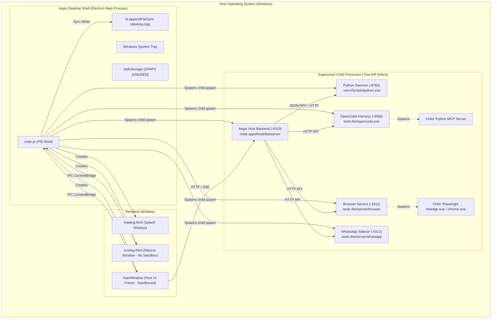

# Production Readiness Audit & Security Architecture Review: Aegis Desktop Shell

**Audit Target**: `aegis/apps/desktop` (Electron Process Supervisor & Desktop Shell)  
**Date**: November 13, 2026  
**Audited By**: Antigravity Swarm Audit Consortium (`@core-audit`, `@security-audit`, `@pack-test`, led by `@report-lead`)  
**Status**: Completed  
**Compliance Directive**: Audit and reporting only. Zero application code modified.

---

## 1. Executive Summary

### 1.1 Current Readiness Rating
**Production Readiness Rating: NOT PRODUCTION READY (Grade: D / Experimental Supervisor Prototype)**

The Aegis Desktop application (`apps/desktop`) currently functions as a **developer workstation process supervisor**, rather than a standalone, distributable desktop product. While it provides an elegant dark-mode splash screen, a persistent Windows system tray icon, and an innovative always-on-top transparent mascot overlay, the underlying architecture suffers from critical defects in process lifecycle supervision, operating system integration, data security, and packaging architecture.

Distributing the current NSIS installer (`Aegis Setup 0.1.0.exe`) to an end-user machine will result in immediate operational failure. The application will fail to discover its backend services, trap the user in a 90-second spinning splash screen, output misleading developer diagnostics, and leave orphaned background processes running indefinitely on the host operating system.

```
+-----------------------------------------------------------------------------------------+
|                                READINESS SCORECARD                                      |
+------------------------------------+-----------+----------------------------------------+
| Dimension                          | Rating    | Primary Deficiency                     |
+------------------------------------+-----------+----------------------------------------+
| 1. Packaging & Distribution        | FAILING   | Hollow ASAR (50KB); zero backends      |
| 2. Process Tree Management         | FAILING   | Windows PID tree leaks; no taskkill /T |
| 3. Security & Sandboxing           | HIGH RISK | Windows ACL leakage; open navigation   |
| 4. Error Handling & Resilience     | POOR      | 90s splash timeout; infinite restarts  |
| 5. Diagnostics & Observability     | POOR      | Unredacted PII in logs; sync disk I/O  |
| 6. Automated Testing & CI          | NON-EXIST | Zero desktop unit/integration tests    |
+------------------------------------+-----------+----------------------------------------+
```

---

### 1.2 Key Architectural Strengths
1. **Lightweight Overlay Architecture**: The mascot overlay window (`createOverlay()`) leverages Electron's transparent, click-through (`setIgnoreMouseEvents`), and taskbar-hidden properties effectively, rendering smooth SVG-based state transitions.
2. **Dedicated Splash & Initialization Pipeline**: The separate `loading.html` splash window provides clean visual feedback and avoids displaying broken webviews while backend services negotiate ports and boot.
3. **Explicit Main Window Sandboxing**: `mainWindow` explicitly configures `contextIsolation: true`, `nodeIntegration: false`, and `sandbox: true`, maintaining Chromium process-level sandboxing for the primary UI frame.
4. **Single-Instance Enforcement**: Electron's `requestSingleInstanceLock()` is correctly invoked early in the startup sequence, cleanly terminating secondary processes and focusing the primary window.
5. **Context Bridge IPC Design**: The preload script (`preload.js`) employs `contextBridge.exposeInMainWorld`, cleanly separating renderer execution contexts from Electron internals.

---

### 1.3 Top Blockers & Critical Risks Summary
1. **Broken Clean-Machine Distribution (PKG-01 / PKG-02)**: The NSIS installer bundles only Electron and a 50 KB ASAR file containing shell HTML/JS. Neither the host server (`apps/host/dist`), Python daemon, OpenCode harness, nor sidecars are bundled. On a clean machine, `resolveRoot()` fails, causing a 90-second frozen splash screen followed by an error directing end-users to run `npm install && npm run build`.
2. **Windows Process Tree Orphan Leaking (ARCH-01 / ARCH-02)**: On Windows, Node's `child.kill()` terminates only the parent launcher process. Supervised child trees (Playwright Chromium, Python MCP servers, cmd.exe wrappers) are never killed on exit or crash. Furthermore, pressing `Ctrl+C` or encountering an unhandled rejection bypasses `will-quit` entirely, permanently stranding background services that lock ports `4310`, `4311`, `4312`, `4096`, and `8765`.
3. **Insecure Windows File Permissions on Secrets (SEC-08)**: Node's `fs.writeFileSync(..., { mode: 0o600 })` is a no-op for Windows NTFS ACLs. Unprotected authentication tokens (`opencode-password`, `browser-secret`, `whatsapp-secret`) are written in plaintext to `.aegis-data/` with inherited read permissions for all local users.
4. **Missing Navigation Controls & Window Open Handlers (SEC-01)**: The main window omits `setWindowOpenHandler` and `will-navigate`. Clicking external links within the React frontend opens unmanaged Electron windows or navigates `mainWindow` away from `http://127.0.0.1:4310` to untrusted external websites while retaining `preload.js` privileges.
5. **Hard Ambient Runtime Dependencies (PKG-03 / ARCH-14)**: The application hard-requires an external Node.js 22+ binary, Python 3.11+ virtual environment, and OpenCode binary on the host machine `PATH`. Electron's internal Node runtime cannot run the host backend due to `node:sqlite` dependency mismatches.

---

## 2. Audit Scope & System Architecture Overview

### 2.1 Audit Scope
The audit consortium evaluated all files within `aegis/apps/desktop` and directly related operational scripts:
- **Core Runtime & Supervision**: `aegis/apps/desktop/main.js` (650 lines)
- **Renderer IPC Bridge**: `aegis/apps/desktop/preload.js` (20 lines)
- **User Interface Shells**: `aegis/apps/desktop/loading.html`, `aegis/apps/desktop/overlay.html`
- **Packaging & Build Scripts**: `aegis/apps/desktop/package.json`, `aegis/apps/desktop/scripts/make-icon.mjs`, `aegis/apps/desktop/scripts/make-icon.py`, `aegis/build-windows.ps1`, `aegis/scripts/supervise-host.mjs`
- **Generated Artifacts & Logs**: `aegis/apps/desktop/release/`, `aegis/.aegis-data/logs/desktop.log`

---

### 2.2 System Architecture Topology

The diagram below illustrates the current supervision model, IPC boundaries, process hierarchy, and communication flows:



---

## 3. Consolidated Findings Matrix

The 25 identified findings are indexed below, classified by severity, domain, and affected system component:

| Finding ID | Domain | Severity | Title | Affected Component |
|:---|:---|:---:|:---|:---|
| **SEC-01** | Security | **CRITICAL** | Missing `setWindowOpenHandler` & Unrestricted Navigation (`will-navigate`) | `main.js:389-433, 435-464` |
| **SEC-08** | Security | **CRITICAL** | Ineffective POSIX File Permissions (`0o600`) on Windows NTFS for Secrets | `main.js:104-116` |
| **ARCH-01**| Core Arch | **CRITICAL** | Windows Process Tree Orphan Leaking on Quit (`child.kill` Tree-Kill Defect) | `main.js:637-647` |
| **ARCH-02**| Core Arch | **CRITICAL** | Absence of SIGINT, SIGTERM, Uncaught Exception & Rejection Handlers | `main.js:590-648` |
| **PKG-01** | Packaging | **CRITICAL** | Clean-Machine Root Discovery Failure Cascade (`resolveRoot` returning `null`) | `main.js:61-89, 602-614` |
| **PKG-02** | Packaging | **CRITICAL** | Hollow ASAR Package (50KB) & Total Omission of Backend Services | `package.json:28-34` |
| **SEC-04** | Security | **HIGH** | Unvalidated IPC Senders Permitting DoS (`aegis:quit`) & Status Spoofing | `main.js:617-627`, `preload.js` |
| **SEC-09** | Security | **HIGH** | Sensitive Token & User Phone Number Logging in Plaintext `desktop.log` | `main.js:50-59, 141, 155-156` |
| **ARCH-04**| Core Arch | **HIGH** | 90-Second UI Splash Freeze on Missing Host Build or Unresolved Root | `main.js:328-330, 333-347, 418` |
| **ARCH-05**| Core Arch | **HIGH** | Infinite Child Process Restart Loop on Fatal Configuration Failures | `main.js:140, 158-167` |
| **ARCH-06**| Core Arch | **HIGH** | Synchronous Disk I/O Blocking Electron Main Event Loop Under Heavy Log Load | `main.js:50-59, 155-156` |
| **PKG-03** | Packaging | **HIGH** | Hard Unbundled Runtime Host Dependencies (Node 22+, Python venv, OpenCode) | `main.js:178-214` |
| **PKG-04** | Packaging | **HIGH** | Executable Metadata & Branding Stripped (`signAndEditExecutable: false`) | `package.json:45` |
| **SEC-02** | Security | **MEDIUM** | Missing Sandbox Configuration on Transparent Mascot Overlay Window | `main.js:451-455` |
| **SEC-05** | Security | **MEDIUM** | Missing Session Permission Request Handler Allowing Ambient Capabilities | `main.js:389-433` |
| **SEC-07** | Security | **MEDIUM** | Insecure Content Security Policy (`'unsafe-inline'`) in Local HTML Shells | `loading.html:5-8`, `overlay.html:5-8` |
| **SEC-10** | Security | **MEDIUM** | Over-Broad Environment Injection (`baseEnv`) Exposing API Keys to Sidecars | `main.js:118-135, 186-331` |
| **ARCH-07**| Core Arch | **MEDIUM** | Flawed Port Probing in `isUp()` Treating Foreign 4xx Services as Healthy | `main.js:169-176` |
| **ARCH-08**| Core Arch | **MEDIUM** | Sequential Blocking Probes in `startServices()` Adding 4.8s Startup Delay | `main.js:185-331` |
| **ARCH-09**| Core Arch | **MEDIUM** | Unbounded `children` Array Accumulating Stale References & Zombie PIDs | `main.js:42, 154, 638-646` |
| **ARCH-10**| Core Arch | **MEDIUM** | Single-Instance Event Fails to Unminimize Minimized Window on Windows | `main.js:478-484, 594` |
| **PKG-05** | Packaging | **MEDIUM** | Missing Multi-Resolution Windows ICO Container (`win.icon` uses flat PNG) | `package.json:44` |
| **PKG-06** | Packaging | **MEDIUM** | Complete Absence of Automated Tests, Linter, and Typechecking Scripts | `package.json:9-15` |
| **SEC-03** | Security | **LOW** | Implicit Web Preferences (`webSecurity`, `allowRunningInsecureContent`) | `main.js:399-404, 451-455` |
| **SEC-06** | Security | **LOW** | Asymmetric IPC Channel Exposure & Listener Accumulation in Overlay Bridge | `main.js:623-627`, `preload.js` |
| **SEC-11** | Security | **LOW** | Shortcut Guard Omitted on Mascot Overlay Window (F12 DevTools Exposure) | `main.js:406, 435-464` |
| **ARCH-11**| Core Arch | **LOW** | Start-at-Login Ignores `openAsHidden` Setting Due to Unconditional `.show()` | `main.js:410, 504-514` |
| **ARCH-12**| Core Arch | **LOW** | Dev Shortcut Lockdown Intercepts Standard In-App Editor Command Palette | `main.js:358-387` |
| **ARCH-13**| Core Arch | **LOW** | Developer Shortcut State Synchronization Latency (15-Second Polling) | `main.js:550, 614` |
| **ARCH-14**| Core Arch | **LOW** | Missing Node.js Binary Validation Leading to Unhandled Spawning Exceptions | `main.js:178-183` |
| **PKG-07** | Packaging | **LOW** | Broken Interoperability Test Harness (`tests/interop_agui.mjs` import failure)| `tests/interop_agui.mjs` |

---

## 4. Detailed Audit Findings

---

### Category A: Critical Severity Findings

#### Finding SEC-01: Missing `setWindowOpenHandler` and Unrestricted Navigation (`will-navigate`)
- **Severity**: **CRITICAL**
- **Domain**: Electron Security & Navigation
- **Affected File & Lines**: `aegis/apps/desktop/main.js` (Lines 389–433, 435–464)
- **Description & Failure Mode**: Neither `mainWindow` nor `overlay` registers a `setWindowOpenHandler` or attaches listeners to navigation lifecycle events (`will-navigate`, `will-redirect`). Within the host React application (`apps/host/src/client`), multiple components (e.g., `ChatTranscript.tsx:80`, `ComputerPanel.tsx:306`, `ResearchPanel.tsx:154`, `PageReviewCard.tsx:155`) render `target="_blank"` anchors for external links (web searches, DOI links, agent-navigated pages).
- **Concrete Scenario**: 
  1. When an end-user clicks any link rendered in the web UI, Electron opens an unmanaged child `BrowserWindow` within Electron's execution space rather than opening the user's default browser (Chrome, Edge, Firefox).
  2. If any link is clicked without `target="_blank"`, or if an attacker exploits an open redirect or XSS vulnerability in the host, `mainWindow` navigates directly away from `http://127.0.0.1:4310` to the remote destination (e.g., `https://attacker.com`).
  3. Once navigated to the external domain, `preload.js` remains active, exposing `window.aegis` to untrusted external JavaScript.
- **Steps to Reproduce**:
  1. In the Aegis UI, input a prompt returning a markdown hyperlink: `[Click Here](https://example.com)`.
  2. Click the link. Observe that Electron either spawns an internal Electron window or navigates `mainWindow` directly to `example.com`.
- **Recommended Fix**:
  Implement strict origin enforcement and delegate all external HTTP/HTTPS protocols to `shell.openExternal`:
  ```javascript
  const ALLOWED_ORIGINS = new Set(['http://127.0.0.1:4310']);

  mainWindow.webContents.setWindowOpenHandler(({ url }) => {
    try {
      const parsed = new URL(url);
      if (['http:', 'https:'].includes(parsed.protocol)) {
        shell.openExternal(url);
      }
    } catch (err) {
      writeLog(`navigation: rejected invalid URL ${url}`);
    }
    return { action: 'deny' };
  });

  mainWindow.webContents.on('will-navigate', (event, url) => {
    try {
      const parsed = new URL(url);
      if (!ALLOWED_ORIGINS.has(parsed.origin)) {
        event.preventDefault();
        if (['http:', 'https:'].includes(parsed.protocol)) {
          shell.openExternal(url);
        }
      }
    } catch {
      event.preventDefault();
    }
  });
  ```

---

#### Finding SEC-08: Ineffective POSIX File Permissions (`mode: 0o600`) on Windows NTFS for Sensitive Secret Files
- **Severity**: **CRITICAL**
- **Domain**: Operating System Security & Credential Protection
- **Affected File & Lines**: `aegis/apps/desktop/main.js` (Lines 104–116)
- **Description & Failure Mode**: `ensureSecret(name, bytes)` attempts to protect generated credentials (`opencode-password`, `browser-secret`, `whatsapp-secret`) by passing `{ mode: 0o600 }` to `fs.writeFileSync`. As documented in official Node.js specifications, POSIX numerical mode flags on Windows only toggle the read-only file attribute; they do NOT configure Windows Discretionary Access Control Lists (DACLs).
- **Concrete Scenario**:
  An ACL audit executed via `icacls "d:\Aegis 2\aegis\.aegis-data"` verified the directory inherits default user permissions:
  `BUILTIN\Users:(I)(RX)`, `NT AUTHORITY\Authenticated Users:(I)(M)`.
  Any unprivileged local user, malware, or background process running in another user context on the same Windows host can read `.aegis-data/opencode-password`, `.aegis-data/browser-secret`, and `.aegis-data/whatsapp-secret`. With these secrets, an attacker can authenticate directly to the OpenCode HTTP server or inject messages into WhatsApp.
- **Steps to Reproduce**:
  1. Open a standard unprivileged Windows PowerShell session.
  2. Run: `Get-Acl ".\.aegis-data\opencode-password" | Format-List AccessToString`.
  3. Notice that `BUILTIN\Users` and `Authenticated Users` have full read access.
- **Recommended Fix**:
  Use Electron's OS-backed `safeStorage` API to encrypt secrets at rest using Windows DPAPI (Data Protection API), with fallback to system user ACL restrictions:
  ```javascript
  const { safeStorage } = require('electron');

  function ensureSecret(name, bytes = 24) {
    const file = path.join(root, '.aegis-data', name);
    if (fs.existsSync(file)) {
      const buffer = fs.readFileSync(file);
      if (safeStorage.isEncryptionAvailable()) {
        try {
          return safeStorage.decryptString(buffer);
        } catch {
          // Fall back if file was stored in plaintext prior to migration
          return buffer.toString('utf8').trim();
        }
      }
      return buffer.toString('utf8').trim();
    }
    const raw = require('node:crypto').randomBytes(bytes).toString('hex');
    const toWrite = safeStorage.isEncryptionAvailable() 
      ? safeStorage.encryptString(raw) 
      : Buffer.from(raw, 'utf8');
    fs.mkdirSync(path.dirname(file), { recursive: true });
    fs.writeFileSync(file, toWrite);
    return raw;
  }
  ```

---

#### Finding ARCH-01: Windows Process Tree Orphan Leaking on Quit (`child.kill` Tree-Kill Defect)
- **Severity**: **CRITICAL**
- **Domain**: Process Supervision & Windows Runtime
- **Affected File & Lines**: `aegis/apps/desktop/main.js` (Lines 637–647) vs `aegis/scripts/supervise-host.mjs` (Line 86) vs `aegis/start.ps1` (Line 238)
- **Description & Failure Mode**: When the application exits, `app.on('will-quit')` iterates over `children` and calls `child.kill()`. On Windows, Node's `child.kill()` invokes `TerminateProcess` strictly on the top-level PID; it does **not** terminate child processes spawned by that PID.
- **Concrete Scenario**:
  1. **Playwright Browser Leak**: The `browser` service (`dist/server/browser/index.js`) spawns Chromium/Edge processes (`chrome.exe`/`msedge.exe`). When Electron calls `child.kill()` on the node launcher, only the node process terminates. The browser processes remain running orphaned in the background, consuming hundreds of megabytes of RAM.
  2. **Python MCP Leak**: `opencode.exe` spawns a Python MCP server (`python.exe -m aegis_daemon.mcp_server`). Killing `opencode.exe` leaves `python.exe` running.
  3. **Port Locking**: When the user restarts Aegis, newly spawned services fail with `EADDRINUSE` because the orphaned children still bind ports `4311`, `4096`, `8765`, and `4310`.
  *(Note: The repository's own PowerShell script `start.ps1` line 238 had to explicitly implement `taskkill /PID $p.Id /T /F` because Node's native kill failed).*
- **Steps to Reproduce**:
  1. Start Aegis via `npm start`.
  2. Ensure browser service or OpenCode spawns a child.
  3. Quit Aegis via system tray "Quit Aegis".
  4. Run `Get-Process chrome, msedge, python, opencode -ErrorAction SilentlyContinue` in PowerShell. Observe lingering processes.
- **Recommended Fix**:
  Use `tree-kill` or native Windows `taskkill.exe /PID <pid> /T /F` on Windows:
  ```javascript
  const { execSync } = require('node:child_process');

  function terminateChildTree(pid) {
    if (process.platform === 'win32') {
      try {
        execSync(`taskkill /PID ${pid} /T /F`, { stdio: 'ignore' });
      } catch {}
    } else {
      try {
        process.kill(-pid, 'SIGKILL');
      } catch {
        try { process.kill(pid, 'SIGKILL'); } catch {}
      }
    }
  }

  app.on('will-quit', () => {
    quitting = true;
    for (const child of children) {
      if (child && child.pid) {
        terminateChildTree(child.pid);
      }
    }
  });
  ```

---

#### Finding ARCH-02: Absence of SIGINT, SIGTERM, Uncaught Exception & Rejection Handlers
- **Severity**: **CRITICAL**
- **Domain**: Runtime Resilience & Signal Handling
- **Affected File & Lines**: `aegis/apps/desktop/main.js` (Lines 590–648)
- **Description & Failure Mode**: `main.js` contains zero listeners for `process.on('SIGINT')`, `process.on('SIGTERM')`, `process.on('uncaughtException')`, or `process.on('unhandledRejection')`.
- **Concrete Scenario**:
  When a developer or automation harness launches the desktop app via CLI (`npm start` or `electron .`) and presses `Ctrl+C` to terminate the process, Node.js delivers `SIGINT` to the Electron main process. Because no `SIGINT` handler exists, the Electron process terminates abruptly without executing the `will-quit` lifecycle event. All 5 child services (daemon, opencode, browser, whatsapp, host) remain permanently orphaned in the Windows background. Subsequent launches fail with port collisions.
- **Steps to Reproduce**:
  1. Run `npm start` in `aegis/apps/desktop`.
  2. In the terminal, press `Ctrl+C`.
  3. Run `netstat -ano | findstr "4310 8765 4096 4311 4312"`. Observe all ports remain open and listening.
- **Recommended Fix**:
  Register global lifecycle termination hooks:
  ```javascript
  function cleanShutdown() {
    if (quitting) return;
    quitting = true;
    writeLog('process: initiating clean shutdown from process signal');
    for (const child of children) {
      if (child?.pid) terminateChildTree(child.pid);
    }
    app.quit();
  }

  process.on('SIGINT', cleanShutdown);
  process.on('SIGTERM', cleanShutdown);
  process.on('uncaughtException', (err) => {
    writeLog(`fatal uncaughtException: ${err?.stack || err}`);
    cleanShutdown();
  });
  process.on('unhandledRejection', (reason) => {
    writeLog(`unhandledRejection: ${reason}`);
  });
  ```

---

#### Finding PKG-01: Clean-Machine Root Discovery Failure Cascade (`resolveRoot` returning `null`)
- **Severity**: **CRITICAL**
- **Domain**: Packaging & Distribution Viability
- **Affected File & Lines**: `aegis/apps/desktop/main.js` (Lines 61–89, 602–614), `aegis/apps/desktop/loading.html` (Lines 146–152)
- **Description & Failure Mode**: `resolveRoot()` relies on `isProductRoot(dir)`, which tests for `apps/host/package.json` AND `services/daemon`. When installed via NSIS (`Aegis Setup 0.1.0.exe`), the executable is placed in `C:\Users\<User>\AppData\Local\Programs\Aegis\Aegis.exe`. `resolveRoot()` walks up 4 directory levels (`Aegis`, `Programs`, `Local`, `AppData`, `<User>`), finds none of the development directories, and returns `null`.
- **Concrete Scenario**:
  On a clean end-user machine without the git repository:
  1. `root` evaluates to `null`.
  2. Logging to disk is disabled (`if (root) logFile = ...`). Logs are routed to `process.stdout`, which is unattached in a Windows GUI executable; all startup diagnostics vanish.
  3. `startServices()` is skipped entirely.
  4. `createWindow()` calls `waitForHost(90_000)` anyway. The splash screen spins for **90 seconds**.
  5. After 90 seconds, the splash screen displays `loading.html?reason=build`, which presents a technical error claiming: *"The host build is missing. The shell found the product folder but apps/host/dist is not built... Build it once: cd apps/host; npm install; npm run build"*.
- **Steps to Reproduce**:
  1. Move the built `release/win-unpacked` folder to an independent directory (e.g., `C:\TestApp\`).
  2. Ensure `AEGIS_ROOT` environment variable is unset.
  3. Launch `Aegis.exe`. Observe 90-second hang followed by developer instructions.
- **Recommended Fix**:
  Decouple production distribution from source directory tree discovery. In production (`app.isPackaged`), resolve resources strictly relative to `process.resourcesPath`:
  ```javascript
  function resolveProductPaths() {
    if (app.isPackaged) {
      return {
        isPackaged: true,
        resourcesDir: process.resourcesPath,
        dataDir: path.join(app.getPath('userData'), 'data'),
        hostEntry: path.join(process.resourcesPath, 'app', 'host', 'index.js'),
        daemonEntry: path.join(process.resourcesPath, 'daemon', 'daemon.exe'),
      };
    }
    // Development mode fallback
    return resolveDevRoot();
  }
  ```

---

#### Finding PKG-02: Hollow ASAR Package (50KB) & Total Omission of Backend Services
- **Severity**: **CRITICAL**
- **Domain**: Packaging & Build Configuration
- **Affected File & Lines**: `aegis/apps/desktop/package.json` (Lines 28–34)
- **Description & Failure Mode**: The `electron-builder` configuration restricts packaged files to:
  ```json
  "files": ["main.js", "preload.js", "overlay.html", "loading.html", "assets/**"]
  ```
  Verified via `@electron/asar.listPackage` on `release/win-unpacked/resources/app.asar`:
  - ASAR file size is only **50,894 bytes** (~50 KB).
  - The package contains zero node dependencies (`dependencies: {}`).
  - Neither `apps/host/dist`, `services/daemon`, `tools-bin/opencode`, nor sidecars (`browser`, `whatsapp`) are copied or referenced via `extraResources` or `extraFiles`.
- **Concrete Scenario**:
  The resulting NSIS installer `Aegis Setup 0.1.0.exe` (81.6 MB) packages only Electron itself and a 50 KB shell script. The entire Aegis agent engine, backend web server, LLM integration, WhatsApp bridge, and browser automation runtime are absent from the installer.
- **Recommended Fix**:
  Configure `electron-builder` to bundle production backends into `extraResources`:
  ```json
  "build": {
    "appId": "com.aegis.desktop",
    "productName": "Aegis",
    "asar": true,
    "files": [
      "main.js",
      "preload.js",
      "overlay.html",
      "loading.html",
      "assets/**"
    ],
    "extraResources": [
      {
        "from": "../host/dist",
        "to": "host"
      },
      {
        "from": "../../services/daemon/dist",
        "to": "daemon"
      },
      {
        "from": "../../tools-bin",
        "to": "tools-bin"
      }
    ]
  }
  ```

---

### Category B: High Severity Findings

#### Finding SEC-04: Unvalidated IPC Senders Permitting DoS (`aegis:quit`) & Status Spoofing
- **Severity**: **HIGH**
- **Domain**: IPC Boundary Security
- **Affected File & Lines**: `aegis/apps/desktop/main.js` (Lines 617–627), `aegis/apps/desktop/preload.js` (Lines 4–18)
- **Description & Failure Mode**: IPC handlers `ipcMain.on('aegis:show')`, `ipcMain.on('aegis:quit')`, and `ipcMain.on('aegis:set-thought')` do not inspect `event.senderFrame.url` or `event.senderFrame.origin`.
- **Concrete Scenario**:
  If the renderer process loads an external webpage or if an untrusted third-party iframe is injected into the DOM, that untrusted origin can execute `window.aegis.quit()`. This immediately kills the desktop shell and all supervised processes without user confirmation. Additionally, `aegis:set-thought` enables any frame to spoof status messages displayed in the system mascot overlay.
- **Recommended Fix**:
  Validate `senderFrame.origin` before acting on IPC messages:
  ```javascript
  const TRUSTED_ORIGIN = 'http://127.0.0.1:4310';

  function isAuthorizedSender(frame) {
    if (!frame) return false;
    try {
      const url = new URL(frame.url);
      return url.origin === TRUSTED_ORIGIN || url.protocol === 'file:';
    } catch {
      return false;
    }
  }

  ipcMain.on('aegis:quit', (event) => {
    if (!isAuthorizedSender(event.senderFrame)) {
      writeLog(`security: rejected unauthorized quit attempt from ${event.senderFrame?.url}`);
      return;
    }
    quitting = true;
    app.quit();
  });
  ```

---

#### Finding SEC-09: Sensitive Token & User Phone Number Logging in Plaintext `desktop.log`
- **Severity**: **HIGH**
- **Domain**: Information Disclosure & Privacy
- **Affected File & Lines**: `aegis/apps/desktop/main.js` (Lines 50–59, 141, 155–156)
- **Description & Failure Mode**: All stdout/stderr chunks from supervised processes are piped directly into `desktop.log` without filtering or token redaction. Line 141 also writes the full service command line and arguments: `writeLog(`service ${name}: start ${command} ${args.join(' ')}`);`.
- **Concrete Scenario**:
  Direct inspection of `d:\Aegis 2\aegis\.aegis-data\logs\desktop.log` revealed unmasked PII and session secrets:
  ```
  whatsapp: {"level":30,"time":1763050000,"pid":55472,"hostname":"...","class":"baileys","node":{"username":"919911258444",...},"msg":"logging in..."}
  ```
  The user's personal phone number, raw Baileys handshake metadata, and command invocation tokens are written in plaintext. The tray menu option *"Open log folder"* (line 516) exposes these files to any user on the machine.
- **Recommended Fix**:
  Implement a stream sanitizer with regex pattern scrubbing for bearer tokens, passwords, API keys, and phone numbers before writing to disk:
  ```javascript
  const REDACTION_PATTERNS = [
    /("username"\s*:\s*")(\d{8,15})(")/gi,
    /(Bearer\s+)[a-zA-Z0-9_\-\.]{16,}/gi,
    /(password|secret|token)=([^&\s]+)/gi,
  ];

  function sanitizeLog(text) {
    let sanitized = text;
    for (const pattern of REDACTION_PATTERNS) {
      sanitized = sanitized.replace(pattern, '$1[REDACTED]$3');
    }
    return sanitized;
  }
  ```

---

#### Finding ARCH-04: 90-Second UI Splash Freeze on Missing Host Build or Unresolved Root
- **Severity**: **HIGH**
- **Domain**: User Experience & Initialization
- **Affected File & Lines**: `aegis/apps/desktop/main.js` (Lines 328–330, 333–347, 418–432)
- **Description & Failure Mode**: In `startServices()`, if the host bundle does not exist, line 329 sets `buildState = 'missing-build'`. However, `waitForHost(90_000)` does not check `buildState`; it repeatedly polls `http://127.0.0.1:4310` until the full 90,000ms timeout expires.
- **Concrete Scenario**:
  When a developer runs `npm start` without running `npm run build` in `apps/host`, or when a user launches the packaged app, the user is forced to wait through a 90-second freeze before the app informs them that the build is missing.
- **Recommended Fix**:
  Abort `waitForHost` immediately if `buildState` is in a terminal error state:
  ```javascript
  async function waitForHost(timeoutMs = 90_000) {
    if (buildState === 'missing-build') {
      return false;
    }
    const start = Date.now();
    while (Date.now() - start < timeoutMs) {
      if (buildState === 'missing-build') return false;
      if (await isUp(HOST_URL)) return true;
      await sleep(300);
    }
    return false;
  }
  ```

---

#### Finding ARCH-05: Infinite Child Process Restart Loop on Fatal Configuration Failures
- **Severity**: **HIGH**
- **Domain**: Process Lifecycle & Fault Tolerance
- **Affected File & Lines**: `aegis/apps/desktop/main.js` (Lines 140, 158–167)
- **Description & Failure Mode**: When a child process exits, `monitorService(name, startFn)` checks if `quitting` is true. If not, it schedules a restart after 15 seconds (`setTimeout(() => startFn(), 15_000)`). No maximum restart threshold or circuit breaker exists.
- **Concrete Scenario**:
  If a service fails due to invalid syntax, missing binary, or port conflict, it restarts every 15 seconds forever. Over hours of running, it continuously consumes CPU cycles, generates gigabytes of log output, and floods the event loop.
- **Recommended Fix**:
  Implement an exponential backoff with a maximum crash count ceiling:
  ```javascript
  const MAX_RESTARTS = 5;
  const restartStats = new Map();

  function scheduleRestart(name, startFn) {
    const stats = restartStats.get(name) || { count: 0, firstCrash: Date.now() };
    stats.count++;
    restartStats.set(name, stats);

    if (stats.count > MAX_RESTARTS) {
      writeLog(`service ${name}: fatal - exceeded ${MAX_RESTARTS} restarts. Service disabled.`);
      return;
    }
    const delay = Math.min(1000 * Math.pow(2, stats.count), 60_000);
    writeLog(`service ${name}: restarting in ${delay}ms (attempt ${stats.count}/${MAX_RESTARTS})`);
    setTimeout(startFn, delay);
  }
  ```

---

#### Finding ARCH-06: Synchronous Disk I/O Blocking Electron Main Event Loop Under Heavy Log Load
- **Severity**: **HIGH**
- **Domain**: Performance & Thread Responsiveness
- **Affected File & Lines**: `aegis/apps/desktop/main.js` (Lines 50–59, 155–156)
- **Description & Failure Mode**: `writeLog(line)` uses `fs.appendFileSync(logFile, ...)` synchronously on Electron's main thread. Child service stdout and stderr streams emit hundreds of chunks per second during startup or batch agent operations.
- **Concrete Scenario**:
  During heavy LLM streaming or Playwright browser automation, synchronous file appending blocks the main thread. This causes noticeable UI frame drops, window dragging stutter, and delayed tray click responses.
- **Recommended Fix**:
  Use asynchronous logging streams (`fs.createWriteStream`) with buffering or asynchronous `fs.promises.appendFile`.

---

#### Finding PKG-03: Hard Unbundled Runtime Host Dependencies (Node 22+, Python venv, OpenCode)
- **Severity**: **HIGH**
- **Domain**: Distribution Architecture
- **Affected File & Lines**: `aegis/apps/desktop/main.js` (Lines 178–214)
- **Description & Failure Mode**:
  - **Node.js**: Line 182 sets `NODE = process.env.AEGIS_NODE || 'node'`. Electron's built-in Node 20 runtime cannot execute the host server because `apps/host` requires Node 22+ for native `node:sqlite`. The application therefore requires an ambient Node 22+ binary installed on the host system.
  - **Python**: Lines 193–195 require `path.join(daemon, '.venv', 'Scripts', 'python.exe')`. Python is not bundled, nor is the virtualenv provisioned automatically.
  - **OpenCode**: Lines 211–214 require `tools-bin/opencode/opencode.exe` pre-downloaded.
- **Concrete Scenario**:
  A user downloading `Aegis Setup.exe` on a fresh Windows machine without pre-installed Node 22, Python 3.11+, and OpenCode will experience immediate crash failures on every service spawn.

---

#### Finding PKG-04: Executable Metadata & Branding Stripped (`signAndEditExecutable: false`)
- **Severity**: **HIGH**
- **Domain**: Windows OS Integration & Security
- **Affected File & Lines**: `aegis/apps/desktop/package.json` (Line 45)
- **Description & Failure Mode**: `package.json` sets `"signAndEditExecutable": false`, disabling `rcedit`.
- **Verification**:
  Inspection via PowerShell `(Get-Item release\win-unpacked\Aegis.exe).VersionInfo`:
  - `FileDescription`: `"Electron"` (instead of `"Aegis"`)
  - `CompanyName`: `"GitHub, Inc."`
  - `ProductName`: `"Electron"`
  - `OriginalFilename`: `"electron.exe"`
- **Impact**:
  In Windows Task Manager, Windows Start Menu search, Volume Mixer, and notification banners, the process displays as generic "Electron" by "GitHub, Inc." with the default Electron atom icon. Furthermore, lack of code signing causes Windows Defender SmartScreen untrusted publisher warnings.
- **Recommended Fix**:
  Enable `signAndEditExecutable: true` (or remove the override) and configure Windows PE resource metadata in `electron-builder` configuration.

---

### Category C: Medium Severity Findings

#### Finding SEC-02: Missing Sandbox Configuration on Mascot Overlay Window
- **Severity**: **MEDIUM**
- **Domain**: Process Sandboxing
- **Affected File & Lines**: `aegis/apps/desktop/main.js` (Lines 451–455)
- **Description & Failure Mode**: While `mainWindow` explicitly enables `sandbox: true` (Line 403), `createOverlay()` omits `sandbox: true` from its `webPreferences`.
- **Impact**: The overlay window renderer runs without OS-level sandboxing. Any memory safety or Chromium rendering engine exploit in the overlay context operates with full un-sandboxed process privileges.
- **Recommended Fix**: Add `sandbox: true` to `overlay.webPreferences`.

---

#### Finding SEC-05: Missing Session Permission Request Handler
- **Severity**: **MEDIUM**
- **Domain**: Permission Sandboxing
- **Affected File & Lines**: `aegis/apps/desktop/main.js` (Lines 389–433)
- **Description & Failure Mode**: `session.defaultSession.setPermissionRequestHandler` is never configured.
- **Impact**: Renderer content can request sensitive browser permissions (camera, microphone, desktop capture, notifications) without explicit main process rejection policies.
- **Recommended Fix**: Implement explicit deny-by-default permission handlers:
  ```javascript
  const { session } = require('electron');

  session.defaultSession.setPermissionRequestHandler((webContents, permission, callback) => {
    callback(false); // Deny all by default
  });
  session.defaultSession.setPermissionCheckHandler(() => false);
  ```

---

#### Finding SEC-07: Insecure Content Security Policy (`'unsafe-inline'`) in Local HTML Shells
- **Severity**: **MEDIUM**
- **Domain**: Web Security & Injection Defense
- **Affected File & Lines**: `aegis/apps/desktop/loading.html` (Lines 5–8), `aegis/apps/desktop/overlay.html` (Lines 5–8)
- **Description & Failure Mode**: Both `loading.html` and `overlay.html` define CSPs containing `script-src 'unsafe-inline'` and `style-src 'unsafe-inline'`. Additionally, `object-src 'none'`, `base-uri 'none'`, and `form-action 'none'` directives are omitted.
- **Recommended Fix**: Extract inline scripts to standalone `.js` files and enforce a strict CSP:
  ```html
  <meta http-equiv="Content-Security-Policy" content="default-src 'none'; script-src 'self'; style-src 'self'; img-src 'self' data:; object-src 'none'; base-uri 'none'; form-action 'none';" />
  ```

---

#### Finding SEC-10: Over-Broad Environment Injection (`baseEnv`) Exposing API Keys to Sidecars
- **Severity**: **MEDIUM**
- **Domain**: Principle of Least Privilege
- **Affected File & Lines**: `aegis/apps/desktop/main.js` (Lines 118–135, 186–331)
- **Description & Failure Mode**: `baseEnv()` reads `.env` and `.env.local` (containing high-value API keys for Anthropic, OpenAI, Google Gemini, Tavily, etc.) and injects the complete merged object into `daemon`, `opencode`, `browser`, `whatsapp`, and `host`.
- **Impact**: The WhatsApp and Browser sidecars only require their local shared secrets (`WHATSAPP_SECRET`, `BROWSER_SECRET`), but receive all LLM provider API keys. A vulnerability in any sidecar dependency exposes all third-party API keys.
- **Recommended Fix**: Construct separate, minimal environment objects tailored per service.

---

#### Finding ARCH-07: Flawed Port Probing in `isUp()` Treating Foreign 4xx Services as Healthy
- **Severity**: **MEDIUM**
- **Domain**: Health Checking & Service Discovery
- **Affected File & Lines**: `aegis/apps/desktop/main.js` (Lines 169–176)
- **Description & Failure Mode**: `isUp()` considers a port healthy if `response.ok || response.status < 500`.
- **Impact**: Any foreign or zombie process occupying the port that returns HTTP `401 Unauthorized`, `403 Forbidden`, or `404 Not Found` is treated as a healthy Aegis service. Aegis skips spawning its own service, connecting to the foreign process instead.
- **Recommended Fix**: Require an explicit application health verification handshake (e.g., verifying a JSON body `{"status": "ok", "service": "aegis-host"}`).

---

#### Finding ARCH-08: Sequential Blocking Probes in `startServices()` Adding 4.8s Startup Delay
- **Severity**: **MEDIUM**
- **Domain**: Startup Latency
- **Affected File & Lines**: `aegis/apps/desktop/main.js` (Lines 185–331)
- **Description & Failure Mode**: Service probes (`await isUp(...)`, 1200ms timeout each) execute serially for Daemon, OpenCode, Browser, and WhatsApp before `host` is spawned.
- **Impact**: When cold-starting without running services, the app incurs up to 4.8 seconds of sequential network timeouts before beginning to launch the host backend.
- **Recommended Fix**: Execute initial probes in parallel via `Promise.allSettled()`.

---

#### Finding ARCH-09: Unbounded `children` Array Accumulating Stale References & Zombie PIDs
- **Severity**: **MEDIUM**
- **Domain**: Memory & Process Management
- **Affected File & Lines**: `aegis/apps/desktop/main.js` (Lines 42, 154, 638–646)
- **Description & Failure Mode**: On service restart, the new child is pushed to `children` without removing dead instances. Over time, `children` accumulates terminated processes. In `will-quit`, `child.kill()` is invoked on stale PIDs that may have been recycled by Windows for other unrelated system processes.
- **Recommended Fix**: Maintain an active `Map<string, ChildProcess>` keyed by service name.

---

#### Finding ARCH-10: Single-Instance Event Fails to Unminimize Minimized Window on Windows
- **Severity**: **MEDIUM**
- **Domain**: Windows Shell Integration
- **Affected File & Lines**: `aegis/apps/desktop/main.js` (Lines 478–484, 594)
- **Description & Failure Mode**: In `second-instance`, `showMain()` calls `mainWindow.show()`. On Windows, calling `.show()` on an already minimized window does not unminimize it; it remains minimized in the taskbar.
- **Recommended Fix**:
  ```javascript
  function showMain() {
    if (!mainWindow || mainWindow.isDestroyed()) return;
    if (mainWindow.isMinimized()) mainWindow.restore();
    mainWindow.show();
    mainWindow.focus();
  }
  ```

---

#### Finding PKG-05: Missing Multi-Resolution Windows ICO Container
- **Severity**: **MEDIUM**
- **Domain**: Asset Packaging
- **Affected File & Lines**: `aegis/apps/desktop/package.json` (Line 44), `scripts/make-icon.mjs`
- **Description & Failure Mode**: `win.icon` references `assets/icon.png`. Windows executable and installer standards require a multi-resolution `.ico` container (`16x16`, `24x24`, `32x32`, `48x48`, `64x64`, `128x128`, `256x256`) to prevent blurriness and visual artifacts across different DPI scaling factors (125%, 150%, 200%).
- **Recommended Fix**: Update `make-icon.mjs` using `png-to-ico` to generate a multi-resolution `icon.ico` and set `"icon": "assets/icon.ico"`.

---

#### Finding PKG-06: Complete Absence of Automated Tests, Linter, and Typechecking Scripts
- **Severity**: **MEDIUM**
- **Domain**: Code Quality & CI/CD
- **Affected File & Lines**: `aegis/apps/desktop/package.json` (Lines 9–15)
- **Description & Failure Mode**: `apps/desktop` defines zero test scripts. Running `npm test` fails with exit code 1 (`npm error Missing script: "test"`). No ESLint or TypeScript configurations exist.
- **Recommended Fix**: Introduce Playwright/Spectron/Vitest desktop smoke tests and configure ESLint.

---

### Category D: Low & Informational Findings

#### Finding SEC-03: Implicit Web Preferences (`webSecurity`, `allowRunningInsecureContent`)
- **Severity**: **LOW**
- **Domain**: Security Hardening
- **Affected File & Lines**: `aegis/apps/desktop/main.js` (Lines 399–404, 451–455)
- **Description**: Security settings are left to default values rather than explicitly declared.
- **Remediation**: Explicitly set `webSecurity: true` and `allowRunningInsecureContent: false` on all webPreferences.

---

#### Finding SEC-06: Asymmetric IPC Channel Exposure & Listener Accumulation
- **Severity**: **LOW**
- **Domain**: IPC Robustness
- **Affected File & Lines**: `aegis/apps/desktop/main.js` (Lines 623–627), `aegis/apps/desktop/preload.js` (Lines 13–17)
- **Description**: `ipcMain.on('aegis:set-thought')` is declared in `main.js` but missing from `preload.js`. Repeated calls to `aegisOverlay.onStatus(cb)` accumulate listeners if not cleaned up.
- **Remediation**: Align IPC channel interfaces and clean previous listeners before attaching new ones.

---

#### Finding SEC-11: Shortcut Guard Omitted on Mascot Overlay Window
- **Severity**: **LOW**
- **Domain**: Developer Mode Lockdown
- **Affected File & Lines**: `aegis/apps/desktop/main.js` (Lines 406, 435–464)
- **Description**: `installShortcutGuard()` is attached to `mainWindow` but omitted from `overlay`.
- **Remediation**: Call `installShortcutGuard(overlay)` in `createOverlay()`.

---

#### Finding ARCH-11: Start-at-Login Ignores `openAsHidden` Setting
- **Severity**: **LOW**
- **Domain**: User Experience
- **Affected File & Lines**: `aegis/apps/desktop/main.js` (Lines 410, 504–514)
- **Description**: The tray menu configures `openAsHidden: true`, but `mainWindow.once('ready-to-show', ...)` calls `mainWindow.show()` unconditionally. The main window opens on every Windows login regardless of user preference.
- **Remediation**: Check `process.argv.includes('--hidden')` or `app.getLoginItemSettings().wasOpenedAsHidden` before showing the window on startup.

---

#### Finding ARCH-12: Dev Shortcut Lockdown Intercepts Standard In-App Editor Command Palette
- **Severity**: **LOW**
- **Domain**: Keyboard Navigation
- **Affected File & Lines**: `aegis/apps/desktop/main.js` (Lines 358–387)
- **Description**: `installShortcutGuard()` blocks `Ctrl+Shift+P` (DevTools command palette), which unintentionally intercepts the standard in-app Monaco/VSCode editor command palette inside the host web app.
- **Remediation**: Refine the shortcut guard filter to avoid blocking in-app text editor shortcuts.

---

#### Finding ARCH-13: Developer Shortcut State Synchronization Latency (15-Second Polling)
- **Severity**: **LOW**
- **Domain**: State Synchronization
- **Affected File & Lines**: `aegis/apps/desktop/main.js` (Lines 550, 614)
- **Description**: `devShortcutsEnabled` is polled from disk via `watchTasks()` every 15 seconds. Toggling developer shortcuts in Settings takes up to 15 seconds to apply in Electron.
- **Remediation**: Expose an IPC event `aegis:set-dev-shortcuts` to update the state immediately upon user change.

---

#### Finding ARCH-14: Missing Node.js Binary Validation
- **Severity**: **LOW**
- **Domain**: Error Diagnostics
- **Affected File & Lines**: `aegis/apps/desktop/main.js` (Lines 178–183)
- **Description**: No pre-flight validation is performed to verify that `NODE` resolves to a functional binary on Windows. If missing, child process spawn throws unhandled `ENOENT` errors.
- **Remediation**: Add a synchronous check via `execSync('node --version')` on startup.

---

#### Finding PKG-07: Broken Interoperability Test Harness (`tests/interop_agui.mjs`)
- **Severity**: **LOW**
- **Domain**: Test Infrastructure
- **Affected File & Lines**: `aegis/tests/interop_agui.mjs`
- **Description**: Attempting to execute `node tests/interop_agui.mjs` fails with `Cannot find module '@ag-ui/client'` because the script attempts to resolve dependencies using `apps/desktop/package.json` rather than the workspace root or host package.
- **Remediation**: Update import resolution to target `apps/host/node_modules/@ag-ui/client`.

---

## 5. Test, Build & Static Check Execution Matrix

Automated verification commands were executed by `@pack-test` across the desktop codebase. The results are summarized below:

| Target / Subject | Verification Command Executed | Exit Code | Result | Audit Findings & Diagnostics |
|:---|:---|:---:|:---:|:---|
| **Main Process Syntax** | `node -c apps/desktop/main.js` | `0` | **PASS** | Valid CommonJS syntax. No syntax errors. |
| **Preload Script Syntax** | `node -c apps/desktop/preload.js` | `0` | **PASS** | Valid CommonJS syntax. |
| **Icon Script (Node)** | `node -c apps/desktop/scripts/make-icon.mjs` | `0` | **PASS** | Valid ESM syntax. |
| **Icon Script (Python)** | `python -m py_compile scripts/make-icon.py` | `0` | **PASS** | Valid Python 3 syntax. |
| **Icon Generation** | `npm run icons` (in `apps/desktop`) | `0` | **PASS** | Successfully generated `icon.png` (256px) & `tray.png` (32px). |
| **Desktop Test Suite** | `npm test` (in `apps/desktop`) | `1` | **FAIL** | `npm error Missing script: "test"`. No test runner configured. |
| **Desktop Linter** | `npx eslint apps/desktop/main.js` | `1` | **FAIL** | `ESLint couldn't find an eslint.config.* file`. |
| **Interop Test Harness** | `node tests/interop_agui.mjs` | `1` | **FAIL** | `Cannot find module '@ag-ui/client'`. Broken import path. |
| **PE Executable Metadata** | `(Get-Item release/win-unpacked/Aegis.exe).VersionInfo` | `0` | **DEFECT** | `FileDescription="Electron"`, `CompanyName="GitHub, Inc."`. Branding missing. |
| **ASAR Contents Check** | `@electron/asar.listPackage(release/.../app.asar)` | `0` | **DEFECT** | Package is only 50 KB. Zero backend services or modules bundled. |
| **Windows NTFS ACL Check** | `icacls ".aegis-data"` | `0` | **DEFECT** | Directory inherits permissive ACLs: `BUILTIN\Users:(I)(RX)`. `0o600` ineffective. |

---

## 6. Strategic Remediation Roadmap

To elevate Aegis Desktop from an experimental internal prototype to a production-grade, distributable desktop product, remediation should proceed across three distinct phases:

```mermaid
flowchart LR
    subgraph P1 ["Phase 1: Process Containment & Security (Immediate)"]
        p1_1["Implement Windows Tree-Kill (taskkill /T)"]
        p1_2["Add SIGINT/SIGTERM/Exception Handlers"]
        p1_3["Register setWindowOpenHandler & will-navigate"]
        p1_4["Encrypt Secrets with safeStorage (DPAPI)"]
        p1_5["Scrub PII & Tokens from desktop.log"]
    end

    subgraph P2 ["Phase 2: Packaging & Clean Distribution"]
        p2_1["Bundle Backends via extraResources"]
        p2_2["Refactor resolveRoot to process.resourcesPath"]
        p2_3["Enable signAndEditExecutable & Add ICO Icons"]
        p2_4["Eliminate 90s Frozen Splash Screen"]
        p2_5["Add Restart Circuit Breaker"]
    end

    subgraph P3 ["Phase 3: Quality Engineering & Hardening"]
        p3_1["Add Desktop Integration Test Suite"]
        p3_2["Configure ESLint & TypeScript Checks"]
        p3_3["Implement Asynchronous Log Streaming"]
        p3_4["Fix Mascot Single-Instance Restore & Shortcut Guard"]
    end

    P1 --> P2 --> P3
```



### Phase 1: Process Containment & Security Hardening (Immediate)
1. **Windows Tree-Kill (`ARCH-01`)**: Replace `child.kill()` with `taskkill /PID <pid> /T /F` on Windows to eliminate orphaned Playwright Chromium, Python MCP, and Node sidecar leaks.
2. **Signal Handling (`ARCH-02`)**: Attach `SIGINT`, `SIGTERM`, `uncaughtException`, and `unhandledRejection` hooks to guarantee graceful shutdown on CLI interrupts.
3. **Navigation Lockdown (`SEC-01`)**: Implement `setWindowOpenHandler` and `will-navigate` origin filtering to prevent `mainWindow` from navigating to untrusted external URLs.
4. **Credential Encryption (`SEC-08`)**: Migrate plaintext `.aegis-data/` secrets to Electron's OS-backed `safeStorage` (Windows DPAPI) to enforce local access isolation.
5. **Log Sanitization (`SEC-09`)**: Add stream redaction filters in `writeLog` to scrub WhatsApp phone numbers, Bearer tokens, and API keys.

### Phase 2: Standalone Packaging & Distribution Architecture
1. **Bundle Backends via `extraResources` (`PKG-02`, `PKG-03`)**: Configure `electron-builder` to package compiled host distributions and runtime binaries into the NSIS installer.
2. **Decouple Root Discovery (`PKG-01`)**: Replace source tree search with `process.resourcesPath` resolution for packaged execution.
3. **Executable Metadata & Icon Packaging (`PKG-04`, `PKG-05`)**: Remove `"signAndEditExecutable": false`, generate multi-resolution `icon.ico`, and properly brand `Aegis.exe`.
4. **Fast-Fail Splash Screen (`ARCH-04`)**: Remove the 90-second spin freeze when the host server fails to spawn, reporting failure immediately.
5. **Restart Circuit Breaker (`ARCH-05`)**: Cap repeated service restarts to 5 attempts with exponential backoff to avoid infinite restart loops.

### Phase 3: Observability, Resilience & Quality Engineering
1. **Automated Testing Suite (`PKG-06`)**: Implement automated Electron smoke tests using Playwright for Electron to verify window spawning, tray menus, and overlay visibility in CI/CD.
2. **Linting & Code Standards (`PKG-06`)**: Add ESLint rules and TypeScript definitions for Electron main and preload scripts.
3. **Non-Blocking Disk I/O (`ARCH-06`)**: Transition `desktop.log` writes to asynchronous buffered streams with automatic log rotation.
4. **Overlay & UX Refinements (`SEC-02`, `SEC-11`, `ARCH-10`, `ARCH-11`)**: Enable sandboxing on the mascot overlay, attach shortcut guards, fix single-instance window un-minimizing, and honor `openAsHidden` at startup.

---

*Report compilation finalized by `@report-lead` on behalf of the Aegis Desktop Audit Consortium.*
