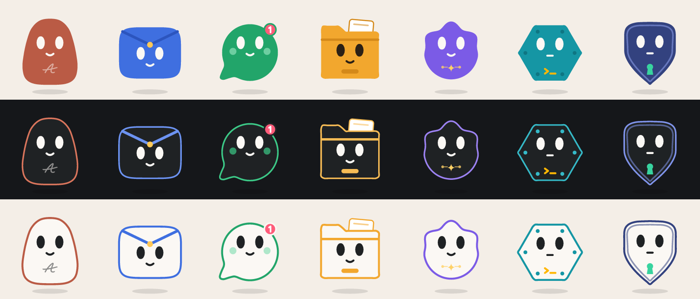
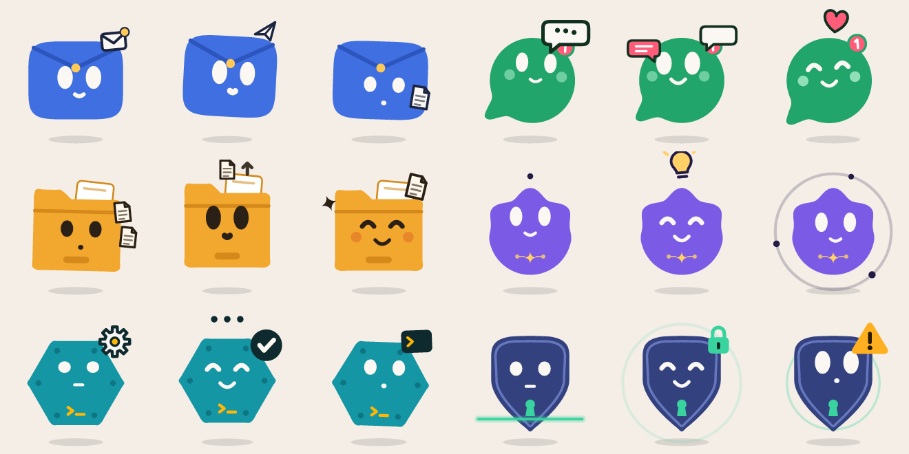
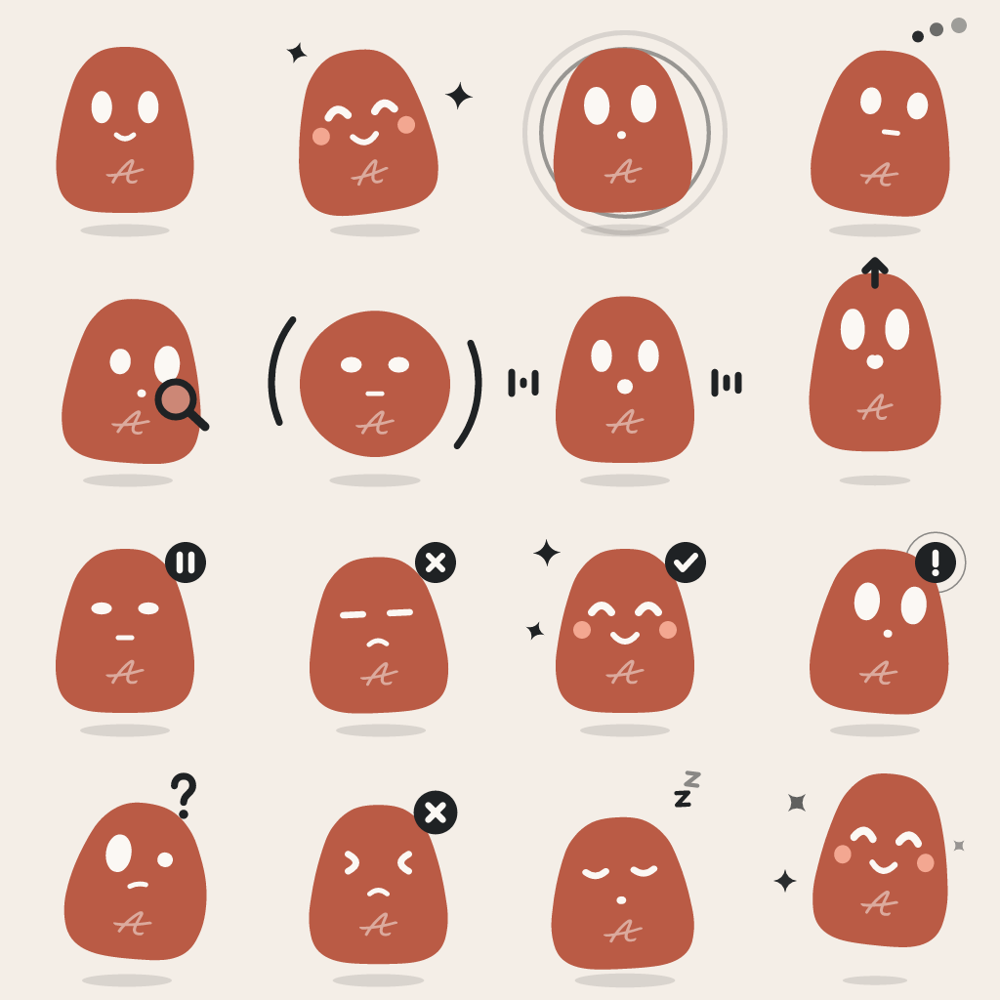
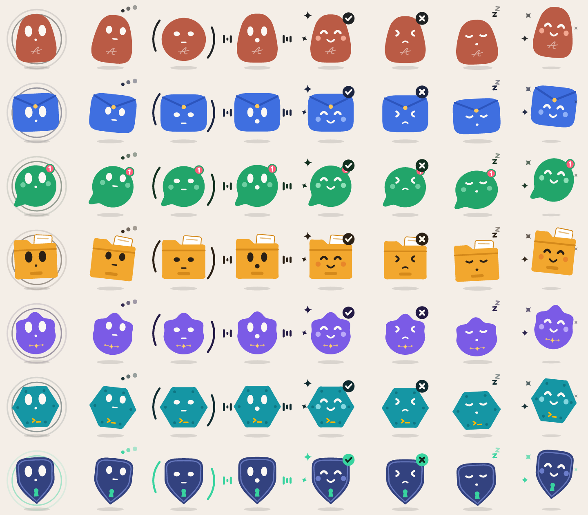
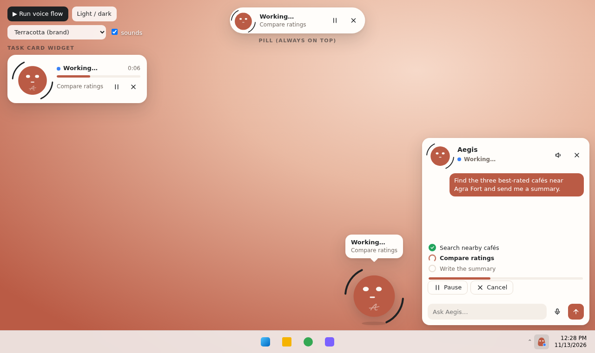

# Aegi and the crew — the Aegis mascots

**7 mascots, one per job.** Aegi is the lead assistant; six specialists take over when their kind of work starts. They share one
face (two oval eyes and a small mouth) so they read as one family, but each has its **own body shape, colour, body details, idle personality
and three signature animations**. Original designs; the "one shape that morphs between states" idea is inspired by [bloub](https://github.com/jeremy-prt/bloub).



| Mascot | Job | Looks like | Colour | Personality (idle) | Signature states |
|---|---|---|---|---|---|
| **Aegi** `aegi` | Lead assistant: Talks to you, plans, and hands work to the specialists | Soft gumdrop with the logo "A" on its chest | #BA5B45 | calm, breathes and glances around | none (plays the common states) |
| **Posty** `mail` | Mail: Reads, drafts, sends and sorts email | Plump envelope with a flap and a gold seal | #3F6FE0 | eager, does a little hop | `mail-incoming`, `mail-sending`, `mail-reading` |
| **Chatty** `social` | WhatsApp & socials: Handles chats, DMs, mentions and posts | Speech bubble with a tail, rosy cheeks and an unread badge | #22A56A | bubbly, sways and smiles | `social-typing`, `social-message`, `social-react` |
| **Filo** `files` | Files: Finds, organises, uploads and converts files | Folder with a tab and a sheet of paper peeking out | #F2A72E | tidy, steady, peeks sideways | `files-organizing`, `files-upload`, `files-found` |
| **Memo** `memory` | Memory: Remembers facts and preferences, recalls context | Little cloud with a spark and two linked nodes | #7B5BE6 | dreamy, floats and looks up | `memory-saving`, `memory-recalling`, `memory-linking` |
| **Rig** `harness` | Harness: Runs tools, commands, tests and builds | Hex nut with bolts and a terminal prompt | #1596A4 | focused, ticks like a machine | `harness-running`, `harness-testing`, `harness-building` |
| **Guard** `security` | Security: Checks permissions, scans, locks and warns | Rounded badge with an inner outline and a mint keyhole | #33427F | watchful, stands firm, eyes sweep left and right | `security-scanning`, `security-locked`, `security-alert` |

## Signature animations



| State | Character | Use it when | Loop | Event | Sound |
|---|---|---|---|---|---|
| `mail-incoming` — **New mail** | Posty | A new email arrived | 2.4s | `mail:new` | `notify` |
| `mail-sending` — **Sending mail** | Posty | An email is being sent | 2s | `mail:send` | `send` |
| `mail-reading` — **Reading mail** | Posty | Reading, summarising or sorting the inbox | 3s | `mail:read` | — |
| `social-typing` — **Typing a reply** | Chatty | Drafting a chat or social reply | 1.8s | `social:typing` | — |
| `social-message` — **New message** | Chatty | New WhatsApp / DM / mention | 2.6s | `social:message` | `receive` |
| `social-react` — **Reacting** | Chatty | Liking, reacting, posting | 2s | `social:react` | `tap` |
| `files-organizing` — **Organising files** | Filo | Moving, renaming, sorting files | 2.4s | `files:organize` | — |
| `files-upload` — **Uploading / saving** | Filo | Uploading, saving, exporting a file | 1.8s | `files:upload` | `send-soft` |
| `files-found` — **File found** | Filo | The file or document was found / opened | 2.2s | `files:found` | `done` |
| `memory-saving` — **Remembering** | Memo | Saving a fact or preference to memory | 2.4s | `memory:save` | `send-soft` |
| `memory-recalling` — **Recalling** | Memo | Looking something up in memory, "I remember…" | 2.6s | `memory:recall` | `receive` |
| `memory-linking` — **Connecting memories** | Memo | Building context, linking notes and past conversations | 3s | `memory:link` | — |
| `harness-running` — **Running tools** | Rig | A tool call / command / pipeline step is running | 1.6s | `harness:run` | `tap` |
| `harness-testing` — **Running checks** | Rig | Tests, evals or validations are running | 2.8s | `harness:test` | — |
| `harness-building` — **Building** | Rig | Writing code, scaffolding, deploying | 2s | `harness:build` | — |
| `security-scanning` — **Scanning** | Guard | Checking permissions, scanning a file / link / request | 2.4s | `security:scan` | — |
| `security-locked` — **Secured** | Guard | Verified, encrypted, access locked | 2.2s | `security:locked` | `done` |
| `security-alert` — **Security alert** | Guard | Risky action, suspicious request, permission needed | 1.6s | `security:alert` | `error` |

## Common states (every mascot plays these 16)



| State (file) | Use it when | Loop | Plays | Suggested sound | Triggering events |
|---|---|---|---|---|---|
| `idle.svg` — **Idle** | Resting, waiting for input | 6s | loops | — | `app:idle` |
| `hello.svg` — **Hello / wake** | App launch, wake word heard, greeting | 2.4s | once, then → `idle` | `wake` | `app:start`, `crew:lead` |
| `listening.svg` — **Listening** | Microphone open, user is speaking | 2.4s | loops | `listen-start` | `mic:start` |
| `thinking.svg` — **Thinking** | Model is reasoning / generating a plan | 3s | loops | — | `mic:stop`, `agent:thinking` |
| `searching.svg` — **Searching** | Web / file / memory search, tool lookups | 3.2s | loops | — | `agent:searching` |
| `working.svg` — **Working / loading** | Long task running, tool executing, loading | 1.6s | loops | — | `agent:working`, `user:resume` |
| `speaking.svg` — **Speaking** | TTS audio is playing | 1.2s | loops | `receive` | `agent:reply`, `agent:speaking` |
| `sending.svg` — **Sending** | Prompt submitted (Enter / send button) | 1.6s | once, then → `thinking` | `send` | `prompt:send` |
| `paused.svg` — **Paused** | User paused the agent / playback | 3s | loops | `pause` | `user:pause` |
| `cancelled.svg` — **Cancelled** | User cancelled / task aborted | 1.8s | once, then → `idle` | `cancel` | `user:cancel` |
| `done.svg` — **Done / success** | Task finished successfully | 2.4s | once, then → `idle` | `done` | `agent:done` |
| `notification.svg` — **Notification** | New message, reminder, something needs attention | 2.2s | loops | `notify` | `notify` |
| `confused.svg` — **Confused** | Didn't understand, low confidence, needs clarification | 3s | loops | `confused` | `agent:confused` |
| `error.svg` — **Error** | Something failed (network, tool, permission) | 2s | loops | `error` | `agent:error` |
| `sleeping.svg` — **Sleeping** | Idle for a long time, do-not-disturb, mic muted | 4s | loops | `sleep` | `app:sleep` |
| `celebrate.svg` — **Celebrate** | Big win, streak, onboarding complete | 1.6s | loops | `celebrate` | `agent:celebrate` |

The same states on every crew member:



Notes
- "once" states (hello, sending, cancelled, done) play one time in the **live component** and then fall through to the next state. The exported SVG files of those states simply loop.
- Every state starts and ends on the same pose, so the files loop without a jump.
- In `working`, Aegi rolls into a ball; the specialists keep their shape.
- Typical flow: `listening` → `sending` → `thinking` → (specialist takes over with a signature state) → `speaking` → `done` → `idle`.

## Colours

Each character has three variants: `color` (its own colour), `dark` (dark body, bright outline in its colour) and `light` (cream body, outline in its colour).

| Character | Body | Detail | Eyes | Props | Highlight | On dark |
|---|---|---|---|---|---|---|
| Aegi | #BA5B45 | #9E4735 | #FBF8F4 | #1F2224 | #FFC857 | #D9755C |
| Posty | #3F6FE0 | #2C55BE | #FBF8F4 | #1B2440 | #FFC857 | #6C93F2 |
| Chatty | #22A56A | #178553 | #FBF8F4 | #12301F | #FF5C7A | #3CC987 |
| Filo | #F2A72E | #D4891A | #2B2015 | #2B2015 | #FFFFFF | #F7BC55 |
| Memo | #7B5BE6 | #6042C8 | #FBF8F4 | #231A45 | #FFD166 | #9C82F2 |
| Rig | #1596A4 | #0E7683 | #FBF8F4 | #0F2A2F | #FFB703 | #35B9C7 |
| Guard | #33427F | #8FA2EE | #FBF8F4 | #38D39F | #38D39F | #7F93EA |

The hues are spread around the colour wheel (terracotta, blue, green, amber, violet, teal, navy) so the crew members are easy to tell apart, and each keeps
one small highlight colour. Extra themes that can be applied to any character: `snow`, `aurora`, `sunset`, `ocean`, `candy`, `neon`.

## What is in this folder

| Path | What it is |
|---|---|
| `svg/animated/<character>/<variant>/<state>.svg` | **Self-animating SVGs** (loop forever, no JavaScript). Use in ``, CSS backgrounds, README files. |
| `svg/static/<character>/<variant>/<state>.svg` | Still frame of every state (icons, fallbacks, reduced-motion). |
| `src/mascot.js` | The live engine: smooth morphing **between** states and characters, custom colours, cursor-following eyes. Zero dependencies. |
| `src/index.js` | Mascot + sounds + widgets + the event map in one import. |
| `src/widgets.js` | Desktop widgets that contain the mascot: pill, desktop pet, tray flyout panel, task card, toast. |
| `tray/` | System-tray icons per character, variant and state (SVG, PNG 16–48, ICO). |
| `INTEGRATION.md` | **The brief to hand to a coding agent**: crew routing, widgets, Electron wiring, IPC contract, checklist. |
| `demo/index.html` | The playground: pick a mascot, try every state, colour, sound and event. The three guides are at the bottom of the page. |
| `demo/widgets.html` | The desktop-widget preview. |
| `electron-example/` | Electron shell: tray icon + flyout + desktop pet + pill, driven over IPC (not run here — reference code). |
| `manifest.json` | Machine-readable list of characters, states, sounds and events. |
| `preview/` | Contact sheets. |

Character = `aegi`, `mail`, `social`, `files`, `memory`, `harness`, `security`; variant = `color`, `dark`, `light`; state = any common state, plus that character's signature states.

## Custom colours and new characters

Any colour can be a hex string **or an array of gradient stops**:

```js
import { AegisMascot, renderSVG } from 'aegis-mascot';

const mine = { body: ['#FF7A59', '#7C3AED'], eye: '#FFFFFF', accent: '#111827', onAccent: '#FFFFFF', blush: '#FDBA74' };
new AegisMascot('#mascot', { character: 'memory', theme: mine, size: 160 });
fs.writeFileSync('thinking.svg', renderSVG({ character: 'memory', state: 'thinking', theme: mine }));   // Node: write your own file
```

To add a crew member: add a body outline to `SHAPES`, an entry to `CHARACTERS` (name, role, shape, face offset, palette, idle `life`), a body detail to
`FEATURE` inside `markup()`, signature states to `STATES` with `for: '<id>'`, events to `src/events.js`, then run `npm run build`.

Options: `emblem` (the body details / logo "A", default on; turn off below ~64 px), `shadow` (ground shadow, default on), `shape` (override the body with one of `aegi`, `mail`, `social`, `files`, `memory`, `harness`, `security`, `leaf`, `orb`, `squircle`, `blob`, `drop`).

## Using it

**1. Just the files** (simplest — works anywhere):

```html


```

**2. Live component** (morphs between states):

```js
import { AegisMascot } from 'aegis-mascot';
const aegi = new AegisMascot('#mascot', { character: 'aegi', theme: 'color', size: 160, follow: true });
aegi.setState('listening');
aegi.setCharacter('files'); aegi.setState('files-found');   // hand over to a specialist
aegi.setCharacter('aegi');
aegi.setState('sending', { then: 'searching' });   // one-shot, then continue somewhere specific
aegi.setTheme('dark'); aegi.setSize(96);
aegi.pause(); aegi.play(); aegi.destroy();
```

**3. Custom element**

```html
<script type="module">import { defineElement } from 'aegis-mascot'; defineElement();</script>
<aegis-mascot character="harness" state="harness-running" theme="dark" size="120" follow></aegis-mascot>
<aegis-mascot state="idle" body="#22c55e" eye="#ffffff" accent="#052e16"></aegis-mascot>
```

**4. Mascot + sounds from app events** (recommended for the voice agent):

```js
import { createAegis } from 'aegis-mascot';
const aegi = createAegis('#mascot', { character: 'aegi', size: 160, sounds: { pack: 'warm', volume: 0.6 } });
aegi.emit('mic:start');     // listening + "listen-start" sound
aegi.emit('prompt:send');   // sending   + "send"
aegi.emit('agent:done');    // done      + "done"
aegi.emit('user:cancel');   // cancelled + "cancel"
aegi.emit('mail:new');      // switches to Posty, plays mail-incoming + "notify"
aegi.emit('crew:lead');     // back to Aegi
```

The event → state → sound map is `EVENTS` in `src/events.js`; pass your own with `createAegis(el, { events })`.

## Widgets and tray



`mountWidget(target, 'pill' | 'pet' | 'panel' | 'card' | 'toast', opts)` gives you the mascot inside a ready-made layout, and `tray/` holds a
per-state icon for the system tray. The full specification — sizes, window flags, IPC, checklist — is in **INTEGRATION.md**.

## Electron

Install as a local package: `npm install ./mascot-kit` (or copy `src/` into your renderer). It is plain ES modules with no
dependencies, so it works with Vite, webpack, or directly with `<script type="module">`.

`electron-example/` is a tray app with a flyout, a desktop pet and a pill. It has not been run in this workspace — Electron is not
installed here — so treat it as reference code. See INTEGRATION.md section 6.

## Good to know

- Animated files use SVG SMIL animation: supported in Chromium/Electron, Firefox and Safari. Checked here in headless Chromium.
- The live component respects `prefers-reduced-motion` (shows the still pose). For files, swap to `svg/static/`.
- Animated files average ~25 KB.
- Regenerate everything: `npm run build` (SVGs, sounds, demo, manifest) and `node tools/docs.mjs` (these docs).
